# Coin Collector Platformer

**INFR 3110U – Game Engine Design & Implementation (Ontario Tech University)**
**Course Project – Check-In (Project Progression)**

- **Name:** Ahmed Mounib
- **Student number:** 100791126
- **Team:** Individual (1 member)
- **Engine:** Unity 6 (6000.5.8f1), C#, and a small C++ plugin
- **Release / build:** [Download the build](https://github.com/AhmedThaGreat/INFR-3110/releases/latest)
- **Video report:** [Watch the video](VIDEO_LINK_HERE)
- **Project board:** [GitHub Projects board](https://github.com/users/AhmedThaGreat/projects/1/views/1)

**More detail on the code:** [flowcharts](docs/flowcharts.md)

---

## 1. Group Formation

### Summary (100 words)

I am working alone. I am a 3D environment artist taking this course as a graduation requirement, so programming is not my main skill. Because of that, I picked a small game (a 3D coin collector) that one person can finish, where every required pattern has an obvious job. I broke the work into weekly steps, kept everything in this GitHub repository, and tracked tasks on a project board. I used an AI assistant (Claude) for most of the code, explained in Section 11. My own focus was the art, the scene, testing, and understanding each part.

### Roles and responsibilities (Ahmed Mounib, 100%)

- **3D / environment artist:** modelled and textured the skull coin, the crystal Gem and the treasure chest (Blender, Substance Painter), and built the look of the scene (sky, lighting, ground).
- **Game designer:** came up with the game, the pickups, the pirate treasure theme, and the idea of rewarding fast play.
- **Programmer (with AI help):** put the AI-written scripts into Unity and Visual Studio, built the plugin, and fixed what broke.
- **Tester:** played and tested every feature, and reported errors and results back (for example, the "You Win!" message appearing twice, and the Hazard not sending the player back).
- **Project manager and documentation:** planned the schedule, kept the project board, wrote this README and the video report.

### Contribution declaration

**Ahmed Mounib: 100%.** I am the only team member. Generative AI help is described in Section 11.

### Gantt chart (plan to complete all deliverables)

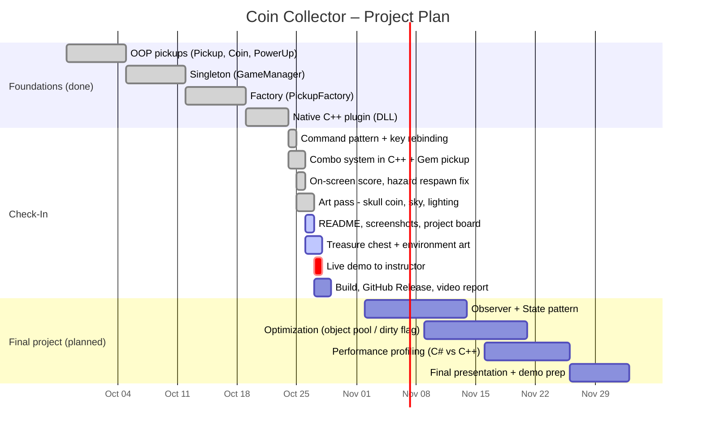

## 2. Game Description and Interactive Media Scenario

**Coin Collector** is a small Mario-inspired 3D platformer with a pirate treasure theme. I made it as a simple test level where each course pattern has a real job to do.

**Purpose:** a playable level that shows the Singleton, Command and Factory patterns and a C++ plugin working inside a game.

**What the player does:** run and jump around a sandy island, collect skull coins, red crystal gems and speed power-ups, avoid the Hazard, and reach the Goal.

**Rules and mechanics:** touching the Hazard sends the player back to the start. Reaching the Goal shows the final score. Collecting pickups quickly builds a combo multiplier (x1 up to x5), so fast play scores more. Move with WASD or arrows, jump with Space, and press F2 to change the jump key.

The scene is small on purpose, so each pattern is easy to see and test.

### Annotated scene

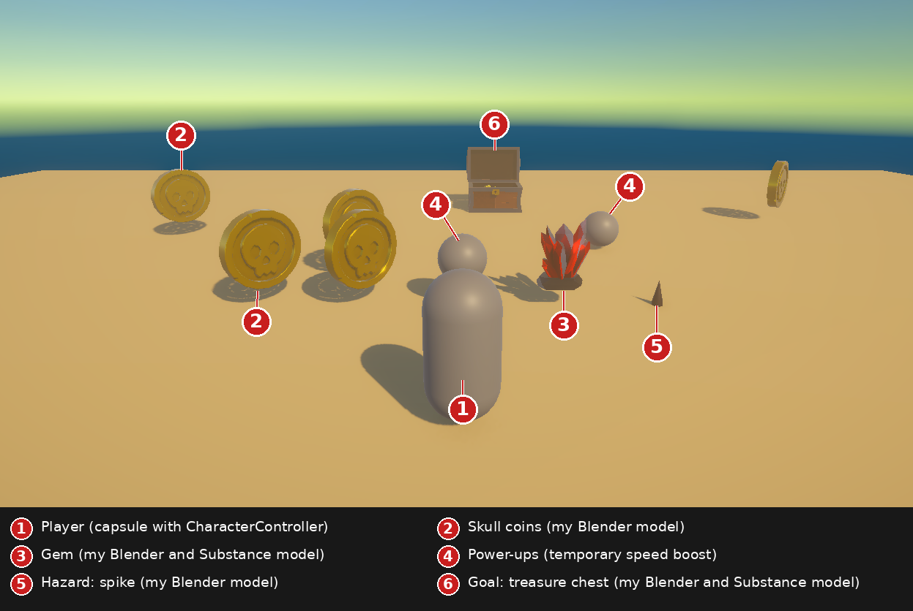

*Annotated screenshot: labels for the Player, a skull coin, a power-up, the hazard and the goal (the treasure chest). The hazard, power-up and player are still placeholder shapes.*

**Why this scene suits the assignment:** it needs one place that keeps the score (Singleton), several kinds of items that get placed in the level (Factory), controls that can be changed (Command), and a small calculation that the C++ plugin can do.

### Controls

| Action | Default key |
| --- | --- |
| Move | W A S D or arrow keys |
| Jump | Space (can be changed) |
| Change the jump key | Press F2, then press the new key (Esc cancels) |

## 3. Art Direction and What I Made

I am an environment artist, so I wanted the scene to look like a real game, not grey boxes. After making a skull coin, I settled on a **pirate treasure** look: gold, red, deep blue sea and warm light.

**Made by me:**

- **Skull coin:** modelled in Blender, with a gold material set up in Unity (metallic and smooth so it catches the light).
- **Crystal Gem:** modelled in Blender and textured in Substance Painter.
- **Scene look in Unity:** a procedural sky material, a warm sun, soft shadows, a sand ground material, a blue sea horizon, and post-processing (bloom, tone-mapping, vignette).
- **Pickups spin and float** so they stand out (small `Spinner` script, written with AI help).

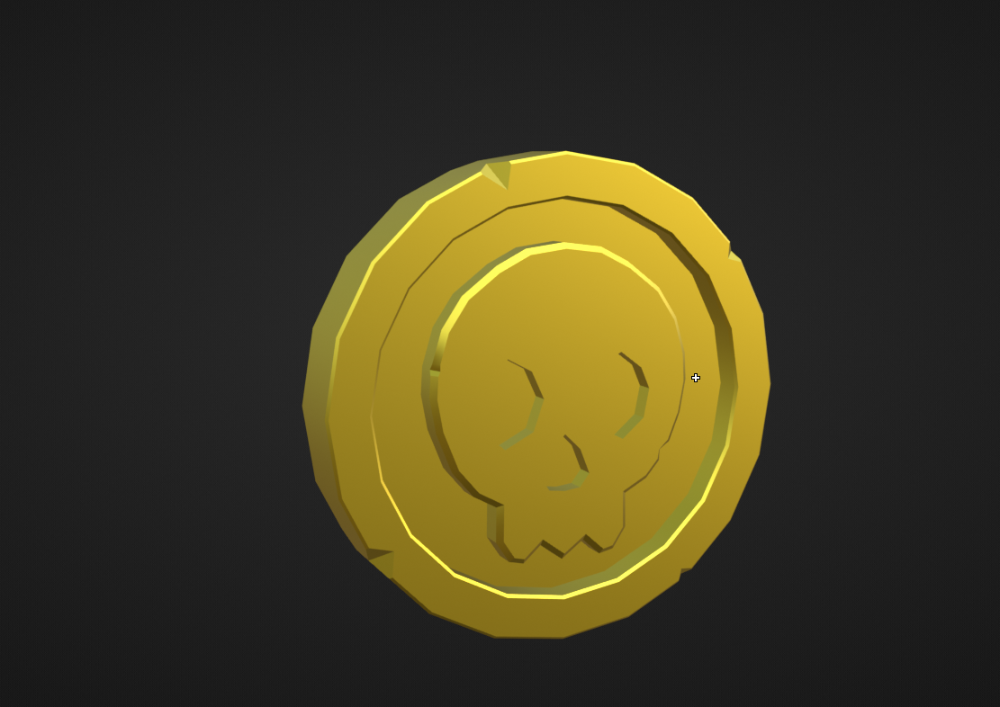

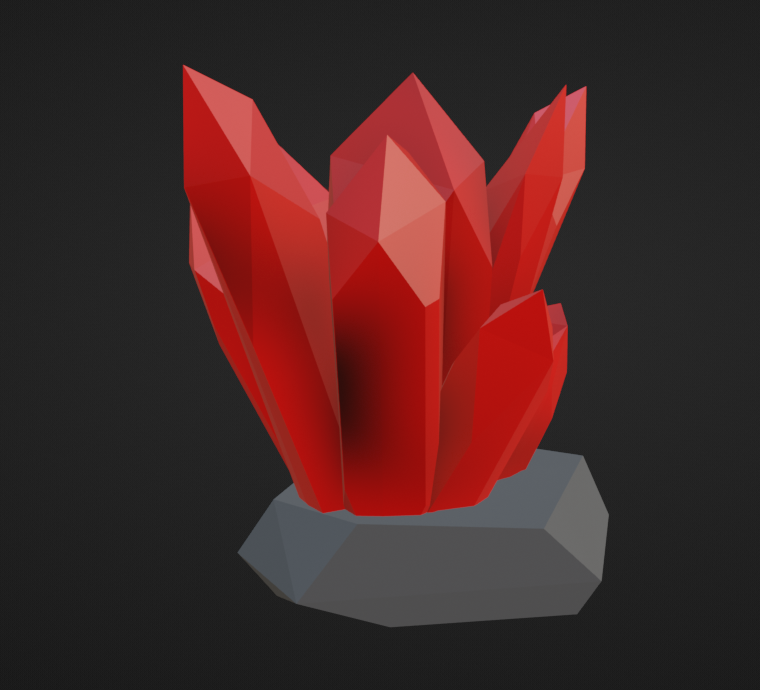

**Treasure chest:** the Goal is now my own treasure chest, modelled in Blender and textured in Substance Painter.

**Still in progress:** the Hazard, the power-up and the player are still simple placeholder shapes for now.

## 4. Singleton Pattern: `GameManager`

**In my own words:** the `GameManager` is the scoreboard for the whole game. It keeps the score and decides what happens when you win or lose. A Singleton is a rule that makes sure there is only **one** scoreboard. Every coin and gem tells that same one scoreboard to add points, so the score can never get out of sync. In 3D terms, it is like having one master file that everything refers to instead of many copies that could disagree.

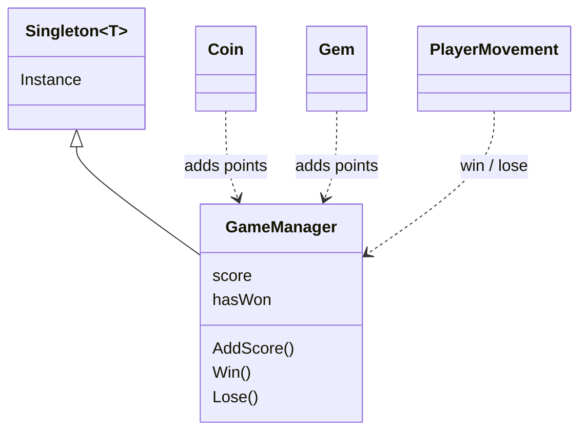

1. Coin or Gem is collected and tells `GameManager.Instance` to add points.
2. `GameManager` asks the C++ plugin for the combo multiplier.
3. It adds (points x multiplier) to the score and shows the score and combo in the corner of the screen.
4. When the player reaches the Goal, it shows "You Win!" and the final score once (it ignores a second trigger).
5. When the player touches the Hazard, it resets the combo and shows "You Lose!" for 3 seconds.

**Why I did it this way:** the score has to exist exactly once, and many different scripts need to reach it. With a Singleton, a new pickup can just call `GameManager.Instance.AddScore()` without me linking anything by hand in the Inspector. The score itself is private, so scripts must go through `AddScore()`, which means the combo is applied in one place only.

**How the game benefits:** adding a new pickup (like the Gem) needed no extra work to connect it to the score. The GameManager also draws the score on screen, so a player of the built game can see what is happening, not just someone watching the Unity Console.

**What I did myself:** I tested it in the Editor and noticed the win message printing twice, which is why the `hasWon` check exists. I also noticed that a built game has no Console, which is why the on-screen display exists.

## 5. Command Pattern: input and changing the jump key

**In my own words:** before, the player script looked straight at the keyboard ("if W is pressed, move forward"). Now each action (move forward, move left, jump) is its own small piece called a **command**, and a separate script (`InputHandler`) keeps a list that says "this key runs that command". It works like the keymap in Blender: the action and the key that triggers it are separate things, so you can change the key without changing the action. That is how I can press **F2** in the game and pick a new jump key while it is running.

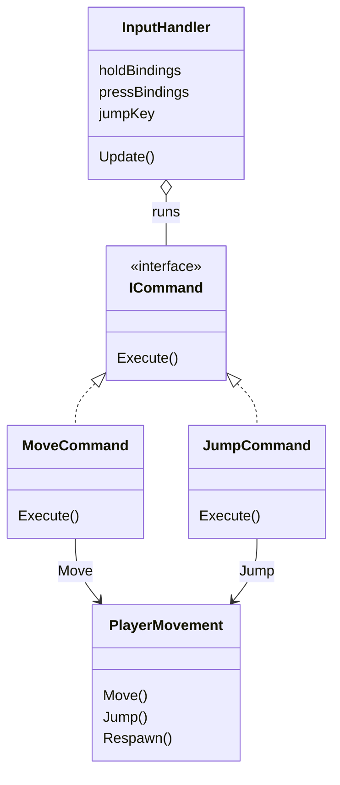

1. Every frame, `InputHandler` checks the held-down keys (W, A, S, D, arrows) and runs the matching move commands.
2. It also checks whether the jump key was just pressed, and runs the jump command.
3. If F2 is pressed, it waits for the next key.
4. If that key is Esc, it cancels. If it is a walking key, it refuses (so you cannot lose your movement). Otherwise the jump command moves to the new key.

**Why I did it this way:** this directly gives the "custom button mapping" idea from the assignment. The player script now only knows *how* to move and jump. It does not know *which key* does it, so changing controls never means editing the player.

**How the game benefits:** players can set their own jump key, and a future action (like a dash) can be added as one new command.

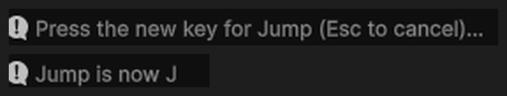

*Proof in Unity's status bar (it shows the latest Console message): after pressing F2 and a new key, "Jump is now J".*

## 6. Factory Pattern: `PickupFactory`

**In my own words:** the `PickupFactory` is like a spawn menu. I tell it "make a Gem here" and it picks the right prefab (a saved, ready-to-use object) and places it in the scene. Whoever asks does not need to know which prefab is behind the Gem. Coin, PowerUp and Gem share one parent (`Pickup`), which handles the touching and the point value once, so each pickup only has to say what happens when it is collected.

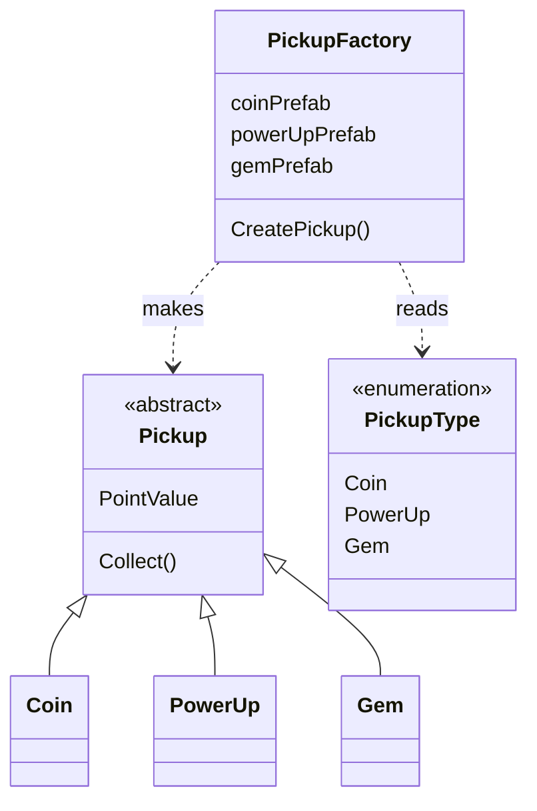

1. A script calls `CreatePickup(Gem, position)`.
2. The factory looks at the type and picks the matching prefab (Coin, PowerUp or Gem).
3. If the prefab exists, it places a copy in the scene at that position.

**Why I did it this way:** the level needs several kinds of collectibles in many places. Keeping the spawning in one method means the level never has to be changed when a new item type is added.

**How the game benefits:** adding the Gem took one new small script (`Gem.cs`), one new entry in the list of types, one prefab slot, and one extra line in the factory. Nothing else in the game had to change. Because the skull coins are spawned from one prefab, swapping in my own coin model once updated every coin in the game.

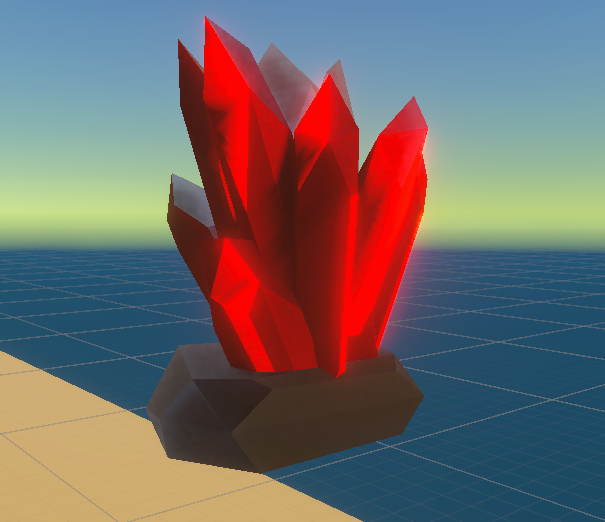

## 7. Plugin / DLL: C++ combo system

**In my own words:** a plugin is a small separate program, written in another language (C++), that Unity can call while the game runs. It is a bit like a Blender add-on that does one job for the main program. Mine keeps track of the **coin combo**. Every time a coin or gem is collected, the game asks the plugin "what is the multiplier now?". If you grabbed the last one within 3 seconds, the combo grows (up to x5). If you waited longer, it goes back to x1.

**How it is built**

- A Visual Studio C++ project that builds a DLL (the plugin file, `NativePlugin.dll`).
- The functions are exposed with `extern "C"` so Unity can find them by their plain names: `GetID`, `SetID`, `GetPosition`, `SetPosition`, `RegisterCoin`, `ResetCombo`. I checked this with the `dumpbin /exports` tool.
- The DLL sits in `Assets/Plugins`, and a C# script (`MyPlugin.cs`) calls the functions with `[DllImport("NativePlugin")]`.

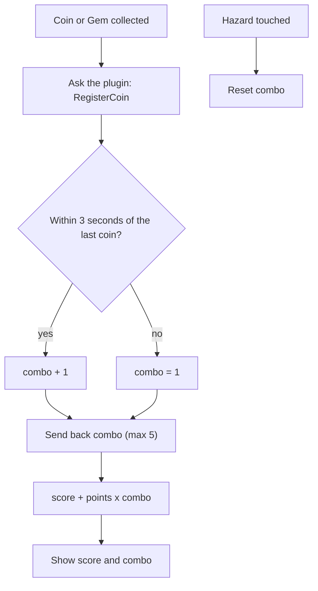

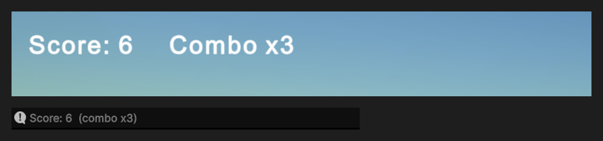

*After three quick coins: the on-screen HUD and the Console line both show "Score: 6 (combo x3)" (1 + 2 + 3).*

**Why this suits my game:** the combo is a small, separate calculation that happens on every pickup and has to remember the last time a coin was grabbed. It is a real gameplay feature that changes how the game plays, and it is simple enough that I can later write the same thing in C# and compare the two for the final project.

**Problems I ran into and fixed**

- The DLL kept disappearing after I built it. Windows Defender was quarantining it, so I added a folder exclusion.
- Unity showed an error saying it could not find the function `SetID`. `dumpbin` showed the DLL had no exports, because I had typed `PLUGIN_EXPORTS` into the wrong box in the Visual Studio settings. I moved it to "Preprocessor Definitions", rebuilt, and it worked.
- To prove the game was really calling the C++ code, I temporarily made the plugin add 200 to the ID, and Unity printed 210 instead of 10.

## 8. Polish and bug fixes

- **Hazard did not send the player back.** I found this when testing the built game. Unity's `CharacterController` ignores a normal position change, so the player stayed where they were. The fix is a `Respawn()` method that switches the controller off for a moment, moves the player to the start, and switches it back on.
- **On-screen score, combo and messages.** A built game has no Console, so the score, combo and "You Win / You Lose" messages are now drawn on the screen by `GameManager`.
- **"You Win!" printed twice.** Fixed with the `hasWon` check (see Section 4).
- **Pickups spin and float** so they are easy to spot (the `Spinner` script on the Coin, PowerUp and Gem prefabs).

## 9. Observer pattern

Observer is not one of the graded items for this check-in. I plan to add it in the final project (for example, letting the score, win and lose events update the UI).

## 10. Project management proof

Tasks and progress are tracked on a [GitHub Projects board](https://github.com/users/AhmedThaGreat/projects/1/views/1). The commit history of this repository also shows the weekly progress.

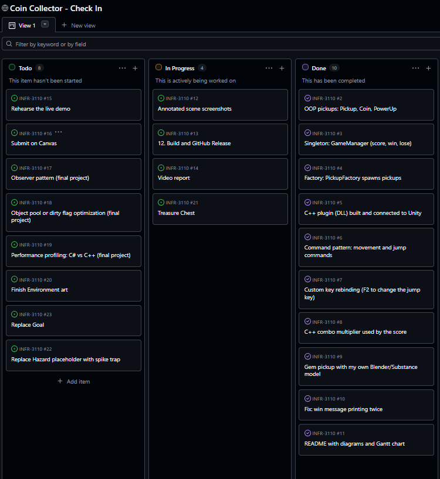

## 11. Generative AI use, third-party resources and citations

### Generative AI disclosure

I used **Claude** as a coding and setup assistant throughout this project.

I am an artist, not a programmer, so **most of the C# and C++ code in this project was written by Claude.** Here is how we worked:

- **How I plan:** because programming is not my strength, I first worked out how each pattern should behave by drawing **flowcharts** on paper (what happens when a coin is collected, what a key press does, what the factory returns). Then I used Claude to help me turn those plans into working code. Clean copies of those flowcharts are in the `docs` folder ([flowcharts](docs/flowcharts.md)).

### Third-party resources

| Item | Source | Notes |
| --- | --- | --- |
| Unity 6 (6000.5.8f1), URP template and `TutorialInfo` folder | Unity Technologies | Default project template, used as provided. |
| Skull coin, Gem and treasure chest models and textures | **Original** (Ahmed Mounib) | Modelled in Blender, textured in Substance Painter. |
| Unity Manual and Scripting API (documentation) | [docs.unity3d.com](https://docs.unity3d.com/) | Used to look up how Unity features work (for example CharacterController, prefabs, lighting). |
| Procedural skybox shader, URP Lit shader, post-processing effects | Unity built-in | Used with my own settings. |
| Sphere, cube, capsule | Unity built-in primitives | Still used for some placeholders (power-up, hazard, player). |
| `Singleton<T>`, `Pickup`, `Coin`, `PowerUp` | Built from course lecture and lab material | Then extended with the combo score, the Gem, and the Command system. |

No other third-party assets, plugins or code are used.

## 12. How to run

1. Install **Unity 6000.5.8f1** and open the project folder.
2. Open `Assets/Scenes/SampleScene` and press **Play**.
3. Or download the build from the **Releases** page, unzip it, and run the `.exe`.
4. To rebuild the plugin: open `NativePlugin/NativePlugin.sln` in Visual Studio, choose **Release / x64**, build, close Unity, and copy `x64/Release/NativePlugin.dll` into `Assets/Plugins`.
