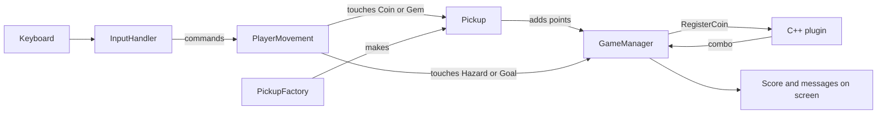
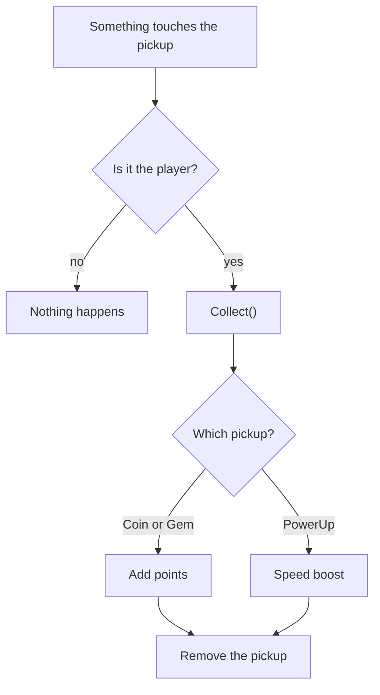
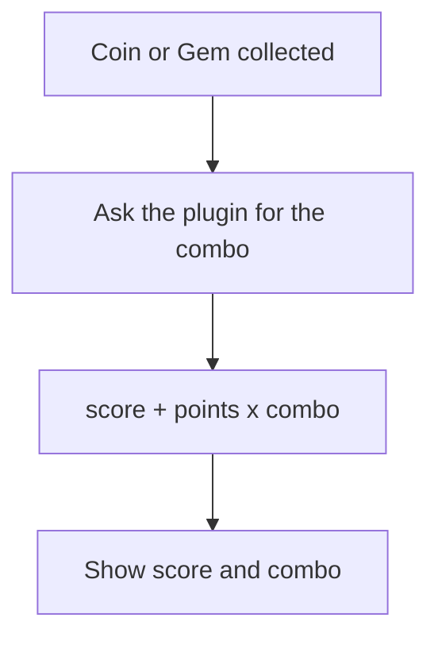
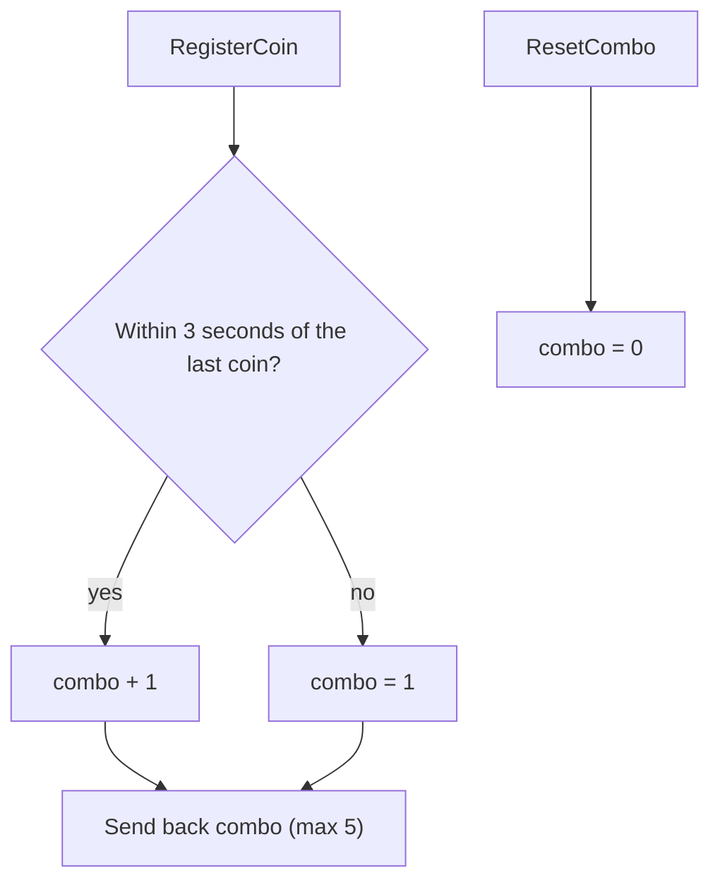
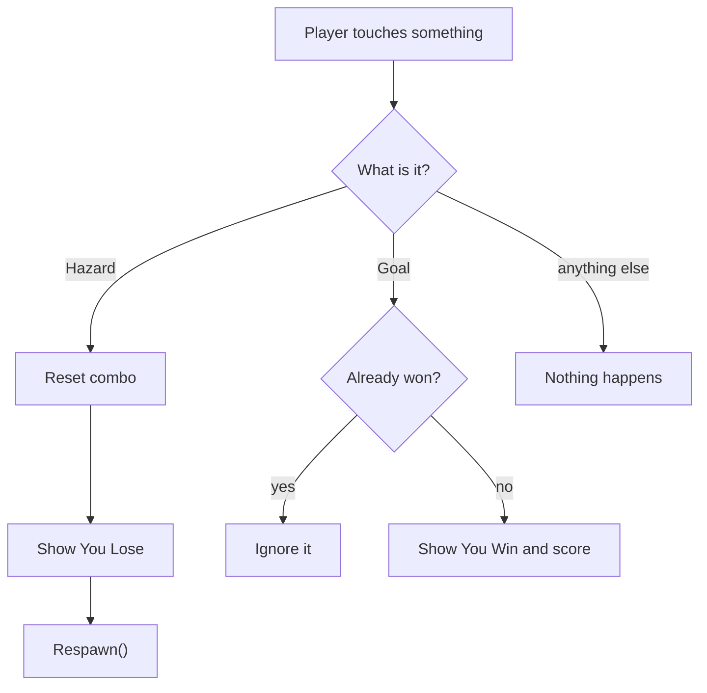
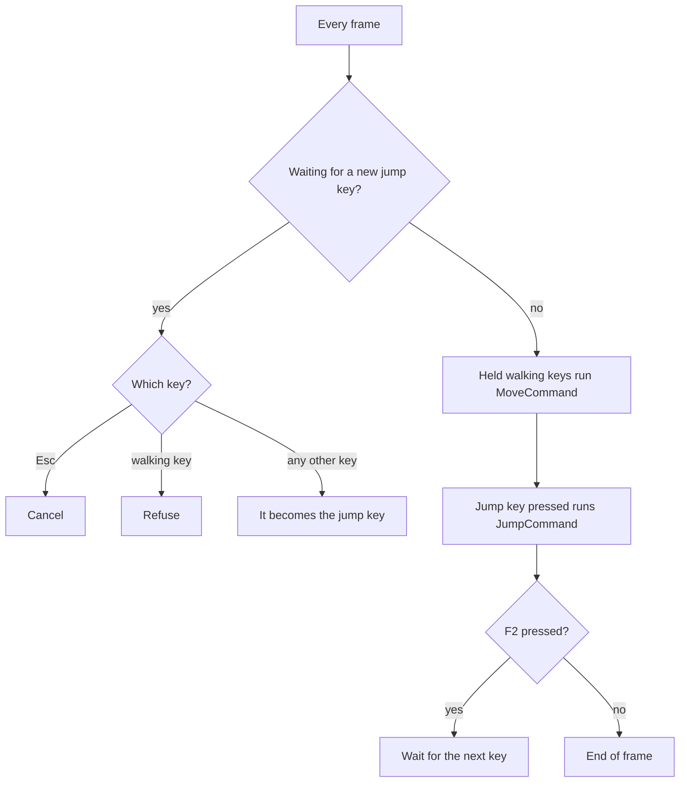
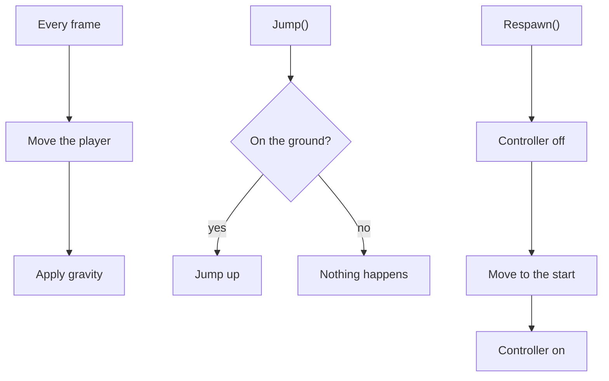
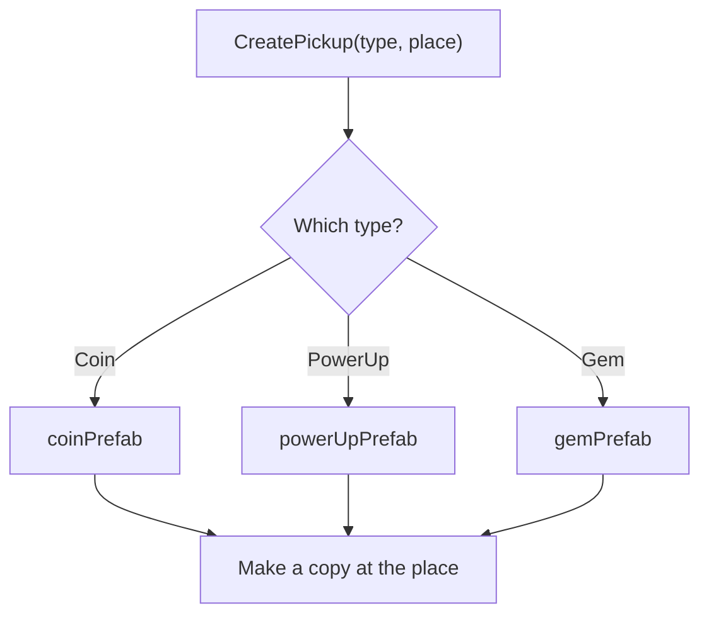
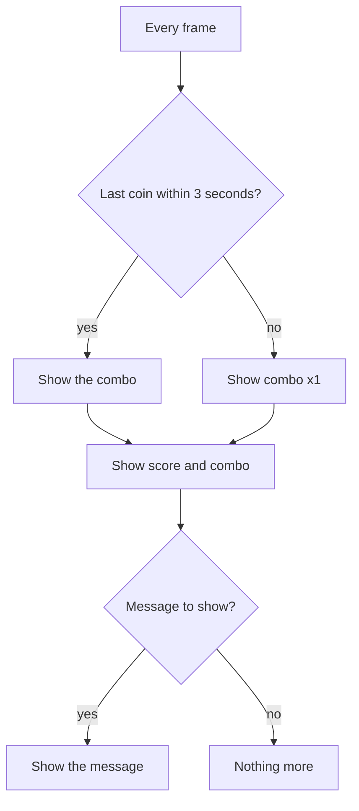

# Flowcharts of the Game Code

Each chart matches one script or system in the project. They use the same names and wording as the diagrams in the README.

---

## 1. How everything fits together

---

## 2. Collecting a pickup

---

## 3. Scoring

---

## 4. The C++ plugin

---

## 5. Win, lose and respawn

---

## 6. Controls and key rebinding

---

## 7. Player movement

---

## 8. Spawning with the factory

---

## 9. Score and messages on screen

